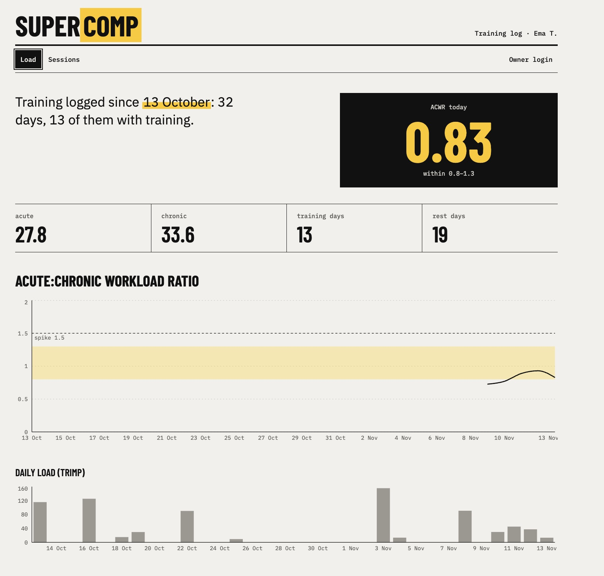
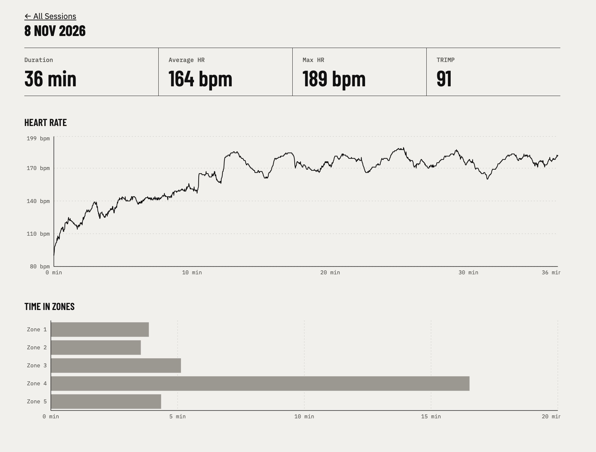

# Supercomp

Supercomp analyzes training load from Garmin `.FIT` files. It calculates the load of each workout from heart rate and uses the history of all workouts to show whether recent training is rising faster than the body is used to.

The name comes from *supercompensation*: you get fitter when load and recovery are in balance.

> **Status:** backend and dashboard are live. Automatic Garmin sync is in progress.

**Live demo:** https://supercomp-nine.vercel.app
**API docs:** https://supercomp.onrender.com/docs
*(free hosting, the first request may take up to a minute to wake the server)*

<p align="center">
  
</p>

## Why I built it

I have a BSc in Sport Science and started training again in October 2026 after a few months off. Coming back too fast is one of the most common causes of overuse injuries, so I wanted to see my own load the way sport science measures it, not only as kilometres or minutes.

Supercomp answers one question: **is my training load rising faster than my body is used to?**


## How it works

1. A `.FIT` file is uploaded and parsed into heart rate samples and a session summary.
2. Time in heart rate zones and training load (TRIMP) are calculated with the athlete's resting and max heart rate.
3. The workout and its raw samples are stored in PostgreSQL.
4. Daily load from all workouts is turned into the acute:chronic workload ratio (ACWR) for each day.
5. A React dashboard shows daily load and ACWR over time, with the 0.8–1.3 range and the 1.5 line marked, plus each workout's heart rate and time in zones.

<p align="center">
  
</p>


### Sport science

| Metric | Method |
| --- | --- |
| Heart rate zones | Karvonen, % of heart rate reserve, zones 1–5 |
| Banister TRIMP | per sample, sex-specific weighting, so hard minutes count much more than easy ones |
| Edwards TRIMP | minutes in each zone × zone number |
| ACWR | 7-day acute vs 28-day chronic load, EWMA (default) or rolling averages |

Rest days count as zero load. ACWR is only reported once 28 days of history exist; before that the status is `insufficient_data`. As a rough guide, values between 0.8 and 1.3 are considered a safe range and values above 1.5 a high-risk spike.

## API

| Method | Endpoint | Description | API key |
| --- | --- | --- | --- |
| `GET` | `/settings` | resting HR, max HR and sex | |
| `PUT` | `/settings` | update settings and recalculate the metrics of all workouts | required |
| `POST` | `/activities/upload` | upload a `.FIT` file | required |
| `GET` | `/activities` | list of workouts, newest first | |
| `GET` | `/activities/{id}` | one workout with its heart rate samples | |
| `GET` | `/load` | daily load and ACWR (`trimp=banister\|edwards`, `method=ewma\|rolling`, `end=YYYY-MM-DD`) | |
| `POST` | `/activities/seed` | fill an empty database with 60 days of synthetic training for a demo | required |
| `GET` | `/auth/check` | check an API key (used by the owner login) | required |
| `GET` | `/health` | health check | |

Endpoints that change data need an API key in the `X-API-Key` header. On the live demo all `GET` endpoints are open to visitors, so the stored data can be explored but not changed. To run locally, set `API_KEY` in `.env`.

In the dashboard, the owner logs in with the same key to upload files; visitors only see the data.

## Tech stack

- **Backend:** Python 3.13, FastAPI, Pydantic, SQLAlchemy, PostgreSQL
- **Data:** pandas, NumPy, fitdecode
- **Frontend:** React 19, TypeScript, Vite, React Router, Recharts
- **Testing:** pytest, FastAPI TestClient, in-memory SQLite
- **Tooling:** Docker Compose, Black, Jupyter for data exploration
- **Hosting:** Render (API), Neon (PostgreSQL), Vercel (frontend)
- **Planned:** GitHub Actions

## Project structure

```
backend/
├── app/
│   ├── parser/fit.py        reads and cleans .FIT files
│   ├── metrics/             zones, TRIMP, ACWR (pure functions, no database)
│   ├── generators/          synthetic training data for the demo
│   ├── activity_metrics.py  metric calculation shared by upload, seed and settings
│   ├── models.py            database tables
│   ├── schemas.py           API request and response models
│   ├── routes/              settings, activities, load, owner
│   └── main.py
├── notebooks/               exploration of real .FIT data
└── tests/                   unit tests for metrics, API tests for routes

frontend/
├── src/
│   ├── api/                 HTTP client and response types, the only place that knows the API URL
│   ├── hooks/               loading / error / data state for API calls
│   ├── auth/                owner login with the API key (kept in sessionStorage)
│   ├── components/          load summary, ACWR chart, sessions, activity detail, upload
│   └── chartTheme.ts        shared chart colors and styles
└── vercel.json              serves index.html for every route
```

The parser only reads data, the metric functions only calculate, and the routes connect them to the database. This keeps the sport science logic testable without a server or database.

## Running locally

Requirements: Python 3.13 and Docker.

Copy the example environment file and adjust the values if needed, then start the database from the repository root:

```bash
cp .env.example .env
docker compose up -d
```

Set up the backend and start the API:

```bash
cd backend
python3 -m venv .venv
source .venv/bin/activate
pip install -r requirements.txt
uvicorn app.main:app --reload
```

Open http://localhost:8000/docs and call `POST /activities/seed` to load demo data, or upload your own `.FIT` file.

### Frontend

Requirements: Node.js 20+.

```bash
cd frontend
npm install
npm run dev
```

Open http://localhost:5173. The API URL comes from `VITE_API_URL` in `.env.development`.


## Tests

```bash
cd backend
pytest

cd ../frontend
npm run lint
npm run build
```

The metric functions are checked against hand-calculated examples and edge cases (empty data, missing heart rate, zero chronic load). The API tests run against an in-memory SQLite database, so they don't need Docker.

## Limitations

- TRIMP is based on heart rate, so it underestimates strength training. Session RPE is planned as a second load measure.
- Max heart rate is a field-measured peak, not a lab test.
- ACWR is a population-level indicator and is debated in the literature; it's a guide, not a diagnosis.
- Days are grouped in UTC.
- Schema changes currently need a database reset; migrations (Alembic) would be the next step.
- Changing athlete settings recalculates all past workouts with the new values. Settings history per date is planned (#43).


## Roadmap

- [x] Deployed backend API
- [x] React dashboard with an ACWR chart and risk zones
- [x] Live dashboard demo
- [ ] Automatic sync from Garmin Connect via the official Personal API, in progress
- [ ] CI with GitHub Actions
- [ ] Session RPE for strength training
- [ ] More realistic heart rate response in the synthetic data
- [ ] Multi-user authentication

## About

Built by Ema Toplek, with a BSc in sport science (University of Graz) and a completed Kolleg in computer science (HTL BULME Graz), to combine training science with data analysis and backend development.